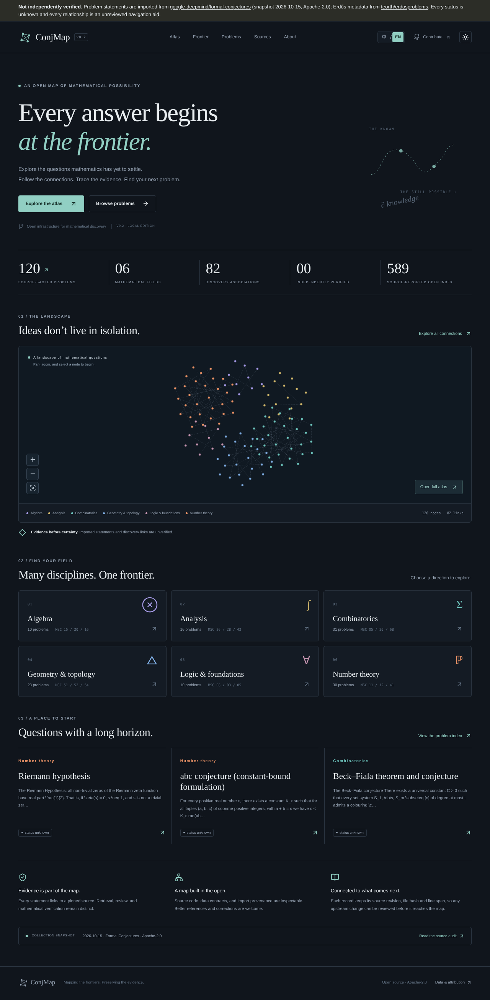

# ConjMap

**Mapping the Frontiers of Mathematics.** An open, interactive, evidence-traceable research map of open problems in mathematics.

**[Open the live atlas](https://ranchotao.com/ConjMap/)** · English / 简体中文

## Data source · 数据来源（未独立核实）

> **Nothing in ConjMap has been independently verified.** 本站所有内容均未经独立核实。

- **All 120 problems** are imported from [google-deepmind/formal-conjectures](https://github.com/google-deepmind/formal-conjectures) (The Formal Conjectures Authors, Apache-2.0), snapshot of **2026-10-15** (revision `2c24ebe7eb2a`). Each record keeps the upstream file, line span and SHA-256. The live snapshot date is shown in the banner at the top of every page and in [`data/manifest.json`](data/manifest.json).
- **Every status is `unknown`.** The upstream `research open` tag is shown as a source label, not as ConjMap's judgement.
- **The 82 relationships are not verified.** They come from shared upstream AMS subject tags and are navigation aids only, not mathematical implications.
- Erdős metadata (32 observations) and the 589-record `/frontier` index come from the community repository [teorth/erdosproblems](https://github.com/teorth/erdosproblems) (Apache-2.0); also unverified.
- 120 个问题全部导入自 DeepMind formal-conjectures（2026-10-15 快照），状态均为“未知”；82 条关联由共享学科标签机械生成，没有核实。

## Upstream sync

[`scripts/sync-formal-conjectures.py`](scripts/sync-formal-conjectures.py) re-reads the same 120 theorems from the latest upstream. It never adds or removes problems and never changes a status. Text and line drift is applied; anything that needs a person (theorem removed, upstream category changed, title/field/AMS tags changed, a reviewed statement changed) is held at the old revision and listed in the report.

The [monthly workflow](.github/workflows/sync-upstream.yml) runs it on the 1st of each month (and can be run by hand from the Actions tab), runs all checks, and opens or refreshes a pull request on branch `sync/formal-conjectures`. **It never merges.** To run it locally:

```sh
git clone --depth 1 https://github.com/google-deepmind/formal-conjectures /tmp/fc
python scripts/sync-formal-conjectures.py --source /tmp/fc --report sync-report.md
npx tsx scripts/build-dedup-report.ts
npm run check
```

## Status

Maintenance only: no new features are planned. The MathForge research-task interfaces (V1 mock, V2 transport) were removed in November 2026 because they never completed a real run. 30 scoped dossiers remain PARTIAL.

## Run locally

Requires Node.js 24 LTS and npm (tested locally on Node 25.2.1; CI targets 24). From a fresh checkout:

```sh
npm run dev
```

The launcher runs `npm ci` if dependencies are absent, then opens a server at **http://127.0.0.1:3000**. Initial dependency installation requires internet; subsequent browsing uses bundled data and local assets, without keys, databases, cloud accounts, or remote fonts. No `.env` file is necessary. Stop with Ctrl+C.

For a production-mode local check:

```sh
npm ci
npm run check
npm start
```

## Languages · 语言

The public atlas and local UI support English and 简体中文. Use the **中 / EN** control in the upper-right corner to switch without navigating away; the preference persists across pages and reloads, with the browser's language used on first visit.

公开网页和本地界面支持英语与简体中文。点击右上角 **中 / EN** 即时切换，语言偏好保存到浏览器。

Problem names, navigation, browsing, graph labels and evidence UI have Chinese labels. The **original mathematical source statements, Lean declarations, original-source audit notes and references remain unchanged in their original language**. This prevents an unreviewed translation from being mistaken for the precise original conjecture or a verified proof. Search accepts original English terms and mapped Chinese problem titles; canonical IDs, source hashes and evidence status never depend on the UI language.

## Open-problem discovery expansion · V0.3

The original 120 full-source dossiers remain unchanged. A separate, auditable
[open-problem source index](/frontier) (live at [/ConjMap/frontier/](https://ranchotao.com/ConjMap/frontier/))
now includes **589 exact `open`-label Erdős records** from an Apache-2.0 pinned repository snapshot.
Of these, **25** are linked by matching Erdős problem numbers to the 120 existing dossiers,
and **564** do not yet have a numbered identity match. These 564 may still overlap under
other names or variants; they are **not** certified unique conjectures.

**Important:** source metadata only — statements and proof/solved status have not been
independently reviewed; mathematical state remains `unknown`. Open the original problem
on its source website for the full statement. This expansion does not claim new
independent mathematical verification. See [V0.3 ingestion and licensing boundaries](docs/frontier-index-v0.3.md).

To check the reproducible, offline index against its fixed source:

```sh
python -m pip install -r requirements-adapters.txt
python adapters/erdos_open_index.py
```

## What ships

- Home, interactive Cytoscape atlas, searchable/sortable/paginated problem index, evidence-rich problem detail, sources, and about pages.
- Responsive layouts and persisted dark/light themes. An accessible node index provides a keyboard alternative to the canvas.
- **120 source statements, 6 fields, 82 unverified discovery associations.** All independent mathematical statuses are **unknown**. Source-reported `research open` is displayed separately. **0 independently verified problems.**
- Two independent licensed adapters: Formal Conjectures statements and 32 Erdős community metadata observations mapped to existing problems. Neutral `cm-000001` IDs retain all legacy `fc-*` links. Second-source observations add **0** independent problems.
- 30 scoped PARTIAL dossiers, seven separate evidence dimensions and append-only review versions. **0 fully cleared dossiers.** Primary literature leads and full-method review gaps are explicit.
- 12 substantive source-reviewed **candidate** relations and 12 declaration nodes (not additional problems); 0 verified relations. Separate navigation, logic, special-case and research-evidence layers; candidates require an explicit toggle.
- Isolated opt-in `/bench` exercises the actual renderer with 100/1,000/5,000 synthetic nodes. [Measured results](docs/performance/v02-graph-benchmark.json) are engineering evidence only.

| Field | Statements |
| --- | ---: |
| Algebra | 10 |
| Analysis | 16 |
| Combinatorics | 31 |
| Geometry & topology | 23 |
| Logic & foundations | 10 |
| Number theory | 30 |

All 120 imports come from **The Formal Conjectures Authors**, `google-deepmind/formal-conjectures`, Apache-2.0, revision `2c24ebe7eb2a79b47f9ffcab618cd611c2bc1ea6`. No whole-site scraping was used. References to other websites remain links, not redistributed copies. Source labels may be stale; imports have not been independently reviewed or checked in Lean. Some selected statements are open variants of famous solved problems; the theorem signature and original file heading are retained.

## Checks

```sh
npm run validate:data
npm run lint
npm run typecheck
npm test
python -m unittest discover -s adapters -p "test_*.py"
npm run build
npx playwright install chromium
npm run test:e2e
```

Python adapter checks require `python -m pip install -r requirements-adapters.txt` (PyYAML, no research service). `npm run check` runs both data validators, lint, typecheck, unit tests and build. Playwright starts its own production server on port 3100, tests browser interactions, and writes screenshots and benchmark measurements. CI uploads reports. See the PR and [V0.2 acceptance report](docs/acceptance-v0.2.md) for executed results; the [V0.1 report](docs/acceptance-report.md) is historical.

## Minimal end-to-end acceptance

1. Run `npm run dev`. Open `/atlas`; pan, zoom, select a node, and follow “Read problem & evidence”. Alternatively use the keyboard-accessible node index.
2. Search `riemannHypothesis` on `/problems`. Select Number theory; toggle sort. Filtering by solved correctly yields no independently established solved entries.
3. Open the Riemann problem. Inspect its KaTeX statement, exact Lean signature, pinned source lines, references, hashes and unknown/unverified labels.
4. Switch themes and inspect mobile width. Visit Sources and About for permissions and limitations.
5. On Atlas select Mathematical logic: verified-only has no links. Enable unverified candidates to inspect amber dashed relations; inspect hypotheses and pinned declarations on problem details.
6. On a dossier page inspect seven evidence dimensions and literature gaps. On Erdős #10 inspect the second-source metadata separately from the mathematical statement/status.

## Documentation

- [Architecture & ADRs](docs/architecture.md)
- [Eight-source audit](docs/source-audit.md) and [bounded access receipts](docs/source-access.json)
- [Data contract & canonicalization](docs/data-contract.md)
- [30 scoped mathematical dossiers and remaining gaps](docs/mathematical-audit-v0.2.md)
- [PostgreSQL evolution schema](docs/postgresql-schema.sql) (design only; not migrated or connected)
- [Acceptance results](docs/acceptance-report.md)
- [Contributing](CONTRIBUTING.md), [license decisions](docs/license-decision.md), [third-party attribution](NOTICE)

## Project boundaries

**Math-CS-AI Atlas** maps learning and knowledge. **ConjMap** maps research problems and evidence. ConjMap does not run research, proofs or verification.

The local server binds loopback. The public site is a static, read-only export on GitHub Pages; there is no API or write path.


