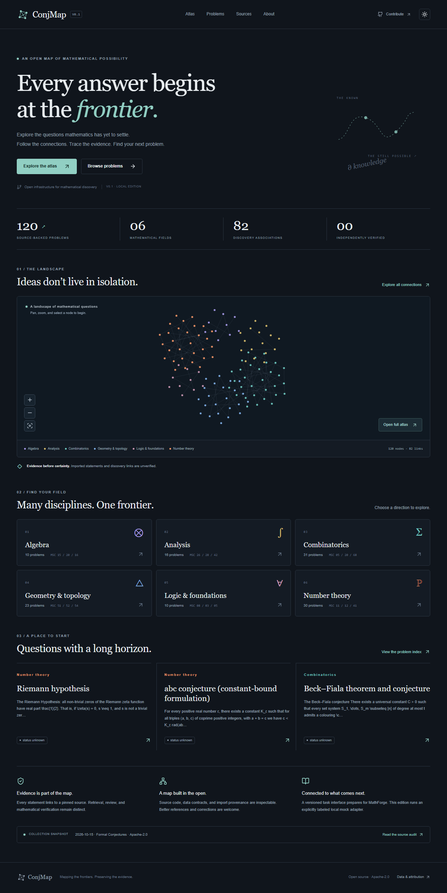

# ConjMap

**Mapping the Frontiers of Mathematics.** An open, interactive, evidence-traceable research map. **V0.4 records one real source-bound MathForge calibration with authenticated receipts and actual logs.** Mathematical clearance remains PARTIAL: three dossiers were reviewed in depth, but no conjecture, proof or graph relation is promoted to verified.

## Run locally

Requires Node.js 24 LTS and npm (tested locally on Node 25.2.1; CI targets 24). From a fresh checkout:

```sh
npm run dev
```

The launcher runs `npm ci` if dependencies are absent, then opens a server at **http://127.0.0.1:3000**. Initial dependency installation requires internet; subsequent browsing uses bundled data and local assets, without keys, databases, cloud accounts, or remote fonts. No `.env` file is necessary. Stop with Ctrl+C.

For a production-mode local check:

```sh
npm ci
npm run check
npm start
```

## Languages · 语言

The public atlas and local UI support English and 简体中文. Use the **中 / EN** control in the upper-right corner to switch without navigating away; the preference persists across pages and reloads, with the browser's language used on first visit.

公开网页和本地界面支持英语与简体中文。点击右上角 **中 / EN** 即时切换，语言偏好保存到浏览器。

Problem names, navigation, browsing, graph labels and evidence UI have Chinese labels. The **original mathematical source statements, Lean declarations, original-source audit notes and references remain unchanged in their original language**. This prevents an unreviewed translation from being mistaken for the precise original conjecture or a verified proof. Search accepts original English terms and mapped Chinese problem titles; canonical IDs, source hashes and evidence status never depend on the UI language.

## Open-problem discovery expansion · V0.3

The original 120 full-source dossiers remain unchanged. A separate, auditable
[open-problem source index](/frontier) (live at [/ConjMap/frontier/](https://ranchotao.com/ConjMap/frontier/))
now includes **589 exact `open`-label Erdős records** from an Apache-2.0 pinned repository snapshot.
Of these, **25** are linked by matching Erdős problem numbers to the 120 existing dossiers,
and **564** do not yet have a numbered identity match. These 564 may still overlap under
other names or variants; they are **not** certified unique conjectures.

**Important:** source metadata only — statements and proof/solved status have not been
independently reviewed; mathematical state remains `unknown`. Open the original problem
on its source website for the full statement. This expansion does not claim new
independent mathematical verification. See [V0.3 ingestion and licensing boundaries](docs/frontier-index-v0.3.md).

To check the reproducible, offline index against its fixed source:

```sh
python -m pip install -r requirements-adapters.txt
python adapters/erdos_open_index.py
```

## What ships

- Home, interactive Cytoscape atlas, searchable/sortable/paginated problem index, evidence-rich problem detail, sources, and about pages.
- Responsive layouts and persisted dark/light themes. An accessible node index provides a keyboard alternative to the canvas.
- **120 source statements, 6 fields, 82 unverified discovery associations.** All independent mathematical statuses are **unknown**. Source-reported `research open` is displayed separately. **0 independently verified problems;1 actual known finite calibration run**, with no general-conjecture conclusion.
- Two independent licensed adapters: Formal Conjectures statements and 32 Erdős community metadata observations mapped to existing problems. Neutral `cm-000001` IDs retain all legacy `fc-*` links. Second-source observations add **0** independent problems.
- 30 scoped PARTIAL dossiers, seven separate evidence dimensions and append-only review versions. **0 fully cleared dossiers.** Primary literature leads and full-method review gaps are explicit.
- 12 substantive source-reviewed **candidate** relations and 12 declaration nodes (not additional problems); 0 verified relations. Separate navigation, logic, special-case and research-evidence layers; candidates require an explicit toggle.
- Research API v1 remains **mock-only**. Independent v2 supports authenticated submission, status polling, signed callbacks, quotas, idempotency and immutable event snapshots. Default requests become **BLOCKED**; no real engine result is fabricated.
- Isolated opt-in `/bench` exercises the actual renderer with 100/1,000/5,000 synthetic nodes. [V0.4 measurements and limits](docs/performance-v0.4.md) are engineering evidence only; V0.2 receipts remain historical.

V0.4 preserves the 589-record metadata index and every original statement. Of the12
historical substantive candidates,9 remain active and3 are challenged/withheld while
their full history remains visible. New review dimensions separate source/statement
inspection, literature, formal correspondence, kernel verification and human approval.
An engine-owned gateway admits exactly one known Fin2 task, with durable provenance,
root-wide quota, recovery/cancellation guards and signed artifact retrieval. Default
unconfigured startup still makes no engine connection. [Actual integration evidence](docs/mathforge-real-integration-v0.4.md)
and [V0.4 acceptance](docs/acceptance-v0.4.md) distinguish real execution, contract tests
and scientific unknowns. The runner is opt-in and must not be used to replay the spent task.

| Field | Statements |
| --- | ---: |
| Algebra | 10 |
| Analysis | 16 |
| Combinatorics | 31 |
| Geometry & topology | 23 |
| Logic & foundations | 10 |
| Number theory | 30 |

All 120 imports come from **The Formal Conjectures Authors**, `google-deepmind/formal-conjectures`, Apache-2.0, revision `2c24ebe7eb2a79b47f9ffcab618cd611c2bc1ea6`. No whole-site scraping was used. References to other websites remain links, not redistributed copies. Source labels may be stale; imports have not been independently reviewed or checked in Lean. Some selected statements are open variants of famous solved problems; the theorem signature and original file heading are retained.

## Checks

```sh
npm run validate:data
npm run lint
npm run typecheck
npm test
python -m unittest discover -s adapters -p "test_*.py"
npm run build
npx playwright install chromium
npm run test:e2e
```

Python adapter checks require `python -m pip install -r requirements-adapters.txt` (PyYAML, no research service). `npm run check` runs all data/archive validators, lint, typecheck, unit tests and build. Playwright starts its own production server on port3100 and tests browser interactions, API boundaries and isolated synthetic graph measurements. CI never launches a real MathForge task. See [V0.4 acceptance](docs/acceptance-v0.4.md); V0.1/V0.2 reports are preserved historical results.

## Minimal end-to-end acceptance

1. Run `npm run dev`. Open `/atlas`; pan, zoom, select a node, and follow “Read problem & evidence”. Alternatively use the keyboard-accessible node index.
2. Search `riemannHypothesis` on `/problems`. Select Number theory; toggle sort. Filtering by solved correctly yields no independently established solved entries.
3. Open the Riemann problem. Inspect its KaTeX statement, exact Lean signature, pinned source lines, references, hashes and unknown/unverified labels.
4. Create a mock request. Simulate a result. Both a failed-route placeholder and a candidate-proof placeholder appear as **MOCK / unverified**. Reload: the journal persists. The problem status stays unknown.
5. Switch themes and inspect mobile width. Visit Sources and About for permissions and limitations.
6. On Atlas select Mathematical logic: verified-only has no links. Enable unverified candidates to inspect amber dashed relations; inspect hypotheses and pinned declarations on problem details.
7. On a dossier page inspect seven evidence dimensions and literature gaps. On Erdős #10 inspect the second-source metadata separately from the mathematical statement/status.
8. Request a real MathForge audit with default configuration: the durable local record is BLOCKED, engine task ID not issued, actual runs 0. Reload and load real request history. This is not a successful research run.
9. Open `/problems/cm-000118` and inspect the archived actual V0.4 run: its engine ID, source, resource measurements and evidence link persist across English/Chinese reloads. Browsing this archive starts no new research. Run `npm run validate:v04` for offline artifact/table checks. The historical `validate:v02` reports its own zero-run baseline separately.

## Documentation

- [Architecture & ADRs](docs/architecture.md)
- [Eight-source audit](docs/source-audit.md) and [bounded access receipts](docs/source-access.json)
- [Data contract & canonicalization](docs/data-contract.md)
- [Research Task API v1 mock / v2 real transport](docs/research-api.md)
- [30 scoped mathematical dossiers and remaining gaps](docs/mathematical-audit-v0.2.md)
- [MathForge capability discovery and integration blocker](docs/mathforge-discovery-v0.2.md)
- [PostgreSQL evolution schema](docs/postgresql-schema.sql) (design only; not migrated or connected)
- [Acceptance results](docs/acceptance-report.md)
- [Contributing](CONTRIBUTING.md), [license decisions](docs/license-decision.md), [third-party attribution](NOTICE)

## Project boundaries

**Math-CS-AI Atlas** maps learning and knowledge. **ConjMap** maps research problems and evidence. **MathForge** executes discovery, research, proofs and verification. ConjMap owns no MathForge execution logic and needs no access to its private repository.

The application binds loopback. V1 is an unauthenticated local mock; V2 adds bearer authentication when configured, signed callbacks, active-task quotas and a separate journal. It remains a local integration boundary, with no public production service, deployment or scheduler configured. JSON stores require trusted filesystem access; interrupted writes may leave locks or unmatched snapshots that require reconciliation before recovery. See the architecture document before evolving storage or exposing an API.


