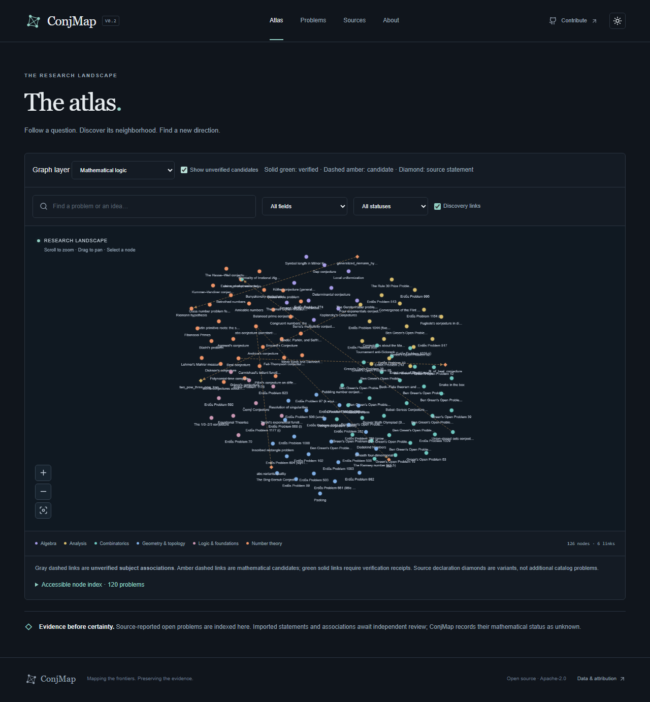
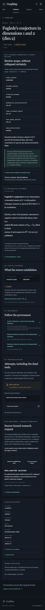

# ConjMap V0.2 acceptance · 2026-10-15

**Overall: PARTIAL.** Engineering implementation is locally tested. Mathematical clearance and a genuine MathForge round trip are not achieved. V0.2 is delivered for PR review, not automatic merge or production deployment.

## Module results

| Module | Result | Executed evidence / remaining gap |
| --- | --- | --- |
| Phase 0 V0.1 closure | DONE | Reviewed PR #1, fixed stable About links, all checks, resolved the actual fixed thread, latest-head CI success, then authorized merge. See `phase0-receipt-v0.2.json`. |
| Independent second source | DONE | Licensed pinned Erdős community YAML; 32 reproducible metadata observations, 0 additional problems; separate metadata/text/linked rights. |
| Neutral identity and dedup | DONE (screening) | 120 persisted `cm-*` IDs, old links resolve, original data untouched. Actual screening: 0 exact, 55 near, 0 equivalence candidates; 0 merges. Semantic equivalence is not established. |
| Mathematical dossiers | PARTIAL | 30 exact-source scoped dossiers with quantifier/variant notes, dated queries, primary leads and gaps. **0 fully cleared rigorous dossiers**, 0 mathematically verified. Full-method, original-priority and expert checks remain. |
| Substantive mathematical graph | PARTIAL | 12 source-reviewed candidates with direction/hypotheses/locators, 12 declaration nodes, 0 verified relations. Four layers implemented; research-evidence layer empty. The target of 10 strictly verified relations is unmet. |
| Real MathForge execution | BLOCKED | Actual source/controller inspected read-only; no compatible generic API/admission mapping. No engine launch, replay or private artifact copying. Actual runs 0. |
| Real transport engineering | DONE (contract-tested) | Auth, quotas, global idempotency, uncertain submission handling, polling, HMAC callback, state/replay checks, independent journal/history/UI. Configured route tests use explicitly identified fixtures, not genuine runs. |
| UI and graph measurement | DONE with limits | Retained original UI; evidence dimensions, source history, candidate layers, real request history. Actual 100/1,000/5,000-node synthetic measurements; 5,000-node pan latency remains high. |
| Local checks | DONE | Both validators, lint, types, build, 44 unit tests, 6 Python tests, 9 Chromium E2E tests pass. Remote CI is a separate required PR check. |

## V0.1 → V0.2

| Quantity | V0.1 | V0.2 |
| --- | ---: | ---: |
| Canonical imported problem statements | 120 | 120 |
| Broad fields | 6 | 6 |
| Integrated independent source repositories | 1 | 2 |
| Added metadata observations / new problems from source 2 | 0 / 0 | 32 / 0 |
| Independent mathematical verifications | 0 | 0 |
| Scoped dossiers / fully cleared dossiers | 0 / 0 | 30 / 0 |
| Unverified subject navigation associations | 82 | 82 |
| Substantive candidates / verified relations | 0 / 0 | 12 / 0 |
| Actual MathForge research runs | 0 | 0 |
| Unit / Python / Chromium tests passing | 25 / 3 / 6 | 44 / 6 / 9 |

All original unit/Python/browser tests remain. `data/problems.json`, `data/relationships.json`, `data/manifest.json` and original pinned Lean files are not reduced/replaced. New registry/source/review overlays preserve provenance. Selected theorem variants are not silently equated with their broad file headings or original numbered sources.

## Local executed checks

- `npm run check`: both validators PASS; 120 statements, 82 navigation edges, hashes/spans/mappings consistent; 32 source observations, 30 review bindings, 12 claim spans and 12 relations validated; lint/typecheck PASS; unit tests PASS; production build PASS.
- `npm test`: **44 passed, 4 files**. Includes configured route authentication → transport fixture → poll → signed callback → journal, replay/corrupt journal/quota/idempotency boundaries, review revocation, layer isolation and the invariant that research results cannot set mathematical status.
- `python -m unittest discover -s adapters -p 'test_*.py'`: **6 passed**; source reproduction, license refusal, metadata scope/counting, duplicate external IDs and unsafe YAML refusal.
- `npm run test:e2e`: **9 passed** on Chromium, final full run 17.7 seconds. Original canvas click/pan/zoom, search/filter/sort/pagination/permalink, theme/mobile/no overflow, mock persistence/API lifecycle remain; V2 blocked persistence, source metadata, evidence dimensions, candidate isolation and synthetic measurement added.
- `npm audit --audit-level=high`: **0 vulnerabilities reported** in the installed npm dependency graph at execution time. This is not an exhaustive security audit or production certification.
- Thirty bounded primary literature lead probes returned HTTP 200, including one truncated PDF prefix with no text extraction. `literature-access-v0.2.json` retains dates, response-prefix hashes and bibliographic metadata only. Access success does not establish proof correctness.

The final E2E store contains **2 completed mock fixture tasks** (3 unverified attempt fixtures total). They are isolated ignored test journals, not shipped mathematical results. Real-adapter default requests are blocked and have no issued engine ID; actual research runs remain 0. Unit-test transport fixtures are excluded from scientific run counts.

## Actual graph measurements

Local Windows x64 / Intel i7-14650HX, Chromium 156.0.8078.4, 1280×900. One actual renderer run per size, 20 scripted pan frames, nearest-rank percentiles. Precise JS heap sampled through Chromium DevTools `Performance.getMetrics`; no forced GC. Raw measurements and hardware/memory context: `performance/v02-graph-benchmark.json`.

| Synthetic nodes / edges | Element replacement + 2 frames | Pan p50 / p95 | Used JS heap |
| --- | ---: | ---: | ---: |
| 100 / 99 | 58.0 ms | 16.6 / 17.7 ms | 13,343,112 bytes |
| 1,000 / 999 | 222.8 ms | 16.8 / 21.0 ms | 24,952,300 bytes |
| 5,000 / 4,999 | 903.3 ms | 85.1 / 231.6 ms | 77,851,340 bytes |

These samples exclude HTTP/import/core initialization, do not measure hardware input-to-photon latency, and do not include native/GPU/RSS memory. No statistical or cross-device guarantee. Memory includes retained browser/component allocations and is not per-node incremental memory. **5,000-node interaction needs further optimization**; clustering, label/edge detail levels and renderer alternatives need controlled comparative measurements. Synthetic fixtures never enter canonical data. `/bench` is opt-in only.

## Boundary walkthrough and visual evidence

Story: a reader selects a problem → inspects pinned statements and evidence dimensions → submits a source-bound request → API validates and journals it → the UI reloads persistent blocked/engine state without promoting mathematical status.

| Boundary | Actual result |
| --- | --- |
| Browser → catalog | Canonical and legacy URLs render; mathematical typesetting, metadata and source links inspected. |
| Layer control → graph | Verified-only has no candidate links; enabling candidates renders amber dashed edges/declaration diamonds. |
| Browser → V2 API | Strict JSON, idempotency, loopback/origin guards and errors exercised. Default request is 202 blocked. |
| API → filesystem → browser | Durable blocked record reloads; timeline shown; engine ID not issued. |
| Configured route → transport → callback | Passed with explicit contract fixtures and fresh signatures; **not a real engine run**. |
| API → actual MathForge execution | **BLOCKED** at compatibility/admission; not bypassed. |





The first browser run exposed scroll-offset hit testing and missing rerender after synthetic graph reinitialization. Both were fixed in application code, preserving original assertions. Initial browser failures are not represented as successful runs. Final screenshots come from the passing suite. Browser no-color warnings are nonblocking.

## Reproduce and review

Fresh checkout: `npm run dev`. No key or `.env` is needed. For full engineering checks install Node 24, Python and requirements, then run:

```sh
npm ci
python -m pip install -r requirements-adapters.txt
npm run check
python -m unittest discover -s adapters -p 'test_*.py'
npm audit --audit-level=high
npx playwright install chromium
npm run test:e2e
```

Follow README's eight manual acceptance steps. Enable the synthetic benchmark only via `CONJMAP_ENABLE_BENCHMARK=1`; no paid service or public deployment is configured. Engine-owned budget enforcement, valid admission, real credentials and a signed genuine result are still needed for real execution.

Remote CI is authoritative at the PR's current head. This committed report records local results and does not predict a remote run. The PR check links and final delivery report supply the subsequently observed run IDs/results, avoiding a self-referential commit/CI assertion. V0.2 must remain unmerged.

## Remaining gates

Full-method review of 30 dossiers, original-formulation fidelity and bibliographic priority remain open; Lean/Coq/kernel checks have not been run. Recent proof/refutation announcements are treated as source claims, never accepted mathematics. Twelve relation candidates need independent scoped proof review; no relation is upgraded for meeting a numeric target. Existing PostgreSQL SQL remains an unexecuted design sketch and has not been migrated for the new overlays. Local journals are trusted-filesystem, single-workspace infrastructure rather than production multi-tenant storage. No external expert review, production security certification, public deployment or genuine new mathematical result is claimed.

Recommended next phase: engine-owned admission gateway for one exact source-bound statement and bounded genuine round trip; parallel independent dossier/formalization review with append-only correction receipts; benchmark-guided graph detail levels. Preserve zero-result and failed-route evidence throughout.
