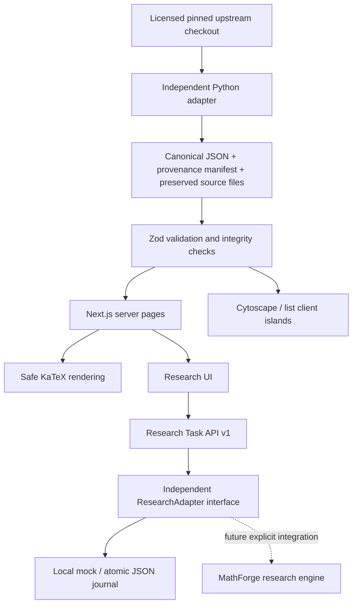

# ConjMap V0.1 architecture

ConjMap catalogs problems and their evidence. It does not reproduce MathForge's research execution logic. All runtime functionality is available locally without external keys.

## ADR-001: requested web stack and offline catalog

Use Next.js App Router, TypeScript, Tailwind's PostCSS integration and semantic CSS tokens, Cytoscape.js, KaTeX, Zod and a standard-library Python adapter. This follows the requested architecture. No alternative framework, paid resource, database provisioning or deployment is required. Static and server-rendered pages provide source content; client components own graph/list/theme interactions. Cytoscape is dynamically imported and destroyed on unmount; a resize observer keeps it sized. A deterministic preset layout groups fields without inventing edges. Canvas has a keyboard-accessible companion index. KaTeX renders with `trust:false`, bounded expansion and size; other source text is escaped by React. No Markdown HTML execution or remote formulas/assets.

## ADR-002: provenance and epistemic separation

All automatic imports are `unverified` with independent `status:unknown` and `last_verified:null`. `source_reported_status:open` is stored separately. A source retrieval date does not establish truth, novelty, current literature status or correctness of a Lean formulation. The selected theorem is visible, including variants of solved classic problems. No Lean toolchain is installed or invoked by this project.

Source is pinned at `2c24ebe7eb2a79b47f9ffcab618cd611c2bc1ea6`. Each of 120 records has a canonical path-derived ID, source theorem identity, exact natural-language comment, exact formal signature, line span, license and SHA-256 of the LF-normalized full source file. Runtime parses schemas; `validate:data` and tests additionally verify all bundled hashes and statement spans. Build uses bundled data and no source website network calls.

The 82 graph associations connect consecutive selected records with an overlapping upstream AMS tag. Their only type is `related_to`; each has both source URLs, an explicit navigation-only basis, `unverified`, and no review date. The graph does not establish any mathematical dependencies. All six requested relationship types exist in the schema for reviewed future data.

## ADR-003: local persistent storage, replaceable adapter

The catalog is version-controlled JSON (read-only in the app). Research tasks are separate, ignored `.local/tasks/<uuid>.json` documents. An independent `ResearchAdapter` interface defines submit/get/list/receive. Atomic temporary-file writes and rename prevent partial JSON reads. Exclusive per-task lockfiles serialize callbacks across worker processes; completed records are immutable and repeated/concurrent callbacks return 409. No automatic task transitions occur on GET, no proof engine executes, and no result changes catalog status.

Locks left by a crash must be inspected with the journal and temporary files before manual recovery. This is a deliberately small local store. Listing scans the task directory and is not suitable for a large multi-user installation. Disk failures return 500 without exposing local paths; corrupt journals fail closed. Tests use fresh temporary directories. E2E uses a separate `.local/e2e-tasks` store; those records do not ship as real research history.

The API checks loopback Host, browser Origin and cross-site fetch metadata; JSON request bodies are bounded to 64 KiB, schemas are strict, IDs are UUIDs, URLs are HTTP(S) only. These checks protect local usage; they are not authentication. Binding to a public interface, forwarding the service, remote callbacks or deploying requires a new authorization, authentication/authorization, webhook signatures, quotas, audit trails and database transactions. Do not point the journal at a shared writable untrusted directory. No arbitrary server fetches, artifact execution or subprocesses come from API inputs.

## ADR-004: storage evolution

`docs/postgresql-schema.sql` documents a future normalized representation: problems, source mappings, aliases, evidence, relationships, tasks and attempts, with checks and foreign keys. The JSON contract remains the interchange format. A future database adapter implements the same interface with transactional state changes and immutable attempt history. The SQL is a design artifact and has **not** been executed. Supabase is neither required nor configured.

## Runtime and performance limits

120 graph nodes are rendered locally; no benchmark claim is made for thousands or millions of nodes. List renders 20 rows per page, searches canonical IDs, aliases, text and MSC, composes field/status filters, and persists filter values into the URL. Theme is stored locally. No external font/image request is needed. Local storage failures do not break the theme toggle. All content stays readable without an account. The English UI is intentional for the open mathematics community; localization is not implemented in V0.1.

## Verification boundaries

Engineering checks cover exact data integrity, schemas, duplicates, reference closure, mock persistence and callback races, host/origin and input boundaries, build/type/lint, real Chromium graph/list/form/navigation interactions and mobile layout. They do not establish semantic deduplication across all mathematics, third-party literature accuracy, proof validity, expert review, production security or publication readiness. `docs/acceptance-report.md` records executed checks and remote CI status separately.
