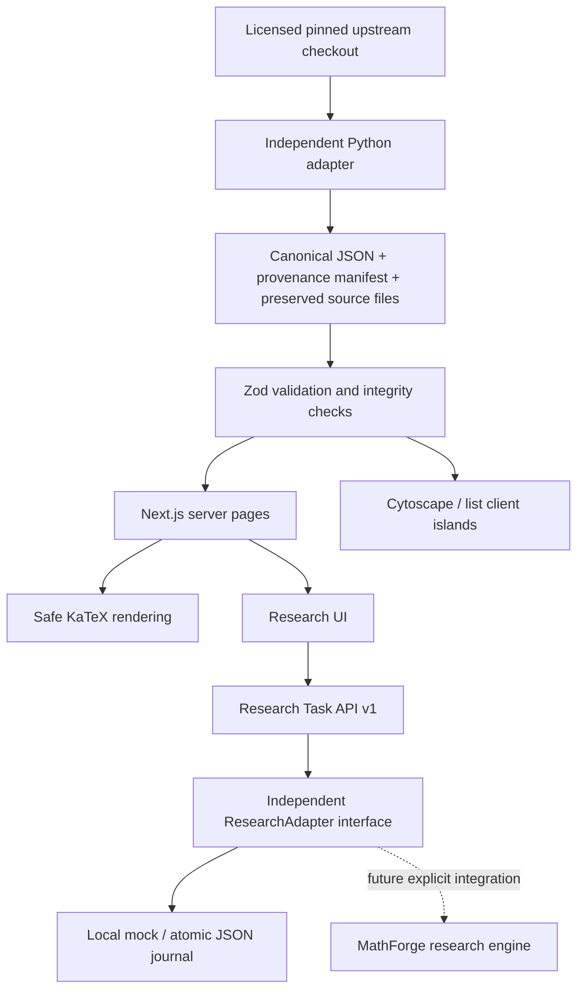

# ConjMap V0.4 architecture

## V0.4: actual scoped execution and appended review history

One engine-owned source-bound Fin2 calibration completed through the real V2 path,
with authenticated engine identity, signed result/attempts/index, actual resource
accounting and six byte-preserved artifacts. Its immutable snapshot is public/read-only;
the live authenticated journal and secrets remain owner-local. Default no-key browsing
does not connect to an engine. See `mathforge-real-integration-v0.4.md`.

V2 now supports engine admission IDs, source binding, rejected/interrupted/cancelled
states, lookup-only uncertain submission recovery, signed narrative verification and
allowlisted named artifact fetches with byte hashes. No result writes catalog status.
MathForge owns scientific admission, the root-wide one-task reservation and fixed
offline computation. ConjMap owns context transport, identity checks, presentation
and persistent evidence. The original Phase0 proof/novelty workflow is unchanged.

Three appended dossier reviews close scoped source/statement obligations while keeping
literature/formal correspondence PARTIAL and kernel/human/mathematical verification
NOT_RUN. All12 original relations remain archived;9 candidates are active and3 challenged
relations are withheld through a reviewed overlay. Original120 statements,82 navigation
edges and589 metadata records remain unchanged. Public static export can show archived
evidence and reviews but excludes live API routes.

The following V0.2 ADRs are retained as a historical baseline; V0.4 supersedes their
real-integration blocker and adds `mathematical-review-v0.4.md`/`relation-verification-v0.4.md`.

ConjMap catalogs problems and their evidence. It does not reproduce MathForge's research execution logic. Catalog browsing, mock tasks and blocked real-request journaling run locally without keys. Real research requires an engine-owned compatible API, which the inspected controller does not expose.

## ADR-005: source-neutral overlays and evidence dimensions

The original 120 source records, 82 navigation edges and SHA manifest stay immutable. A persisted registry maps `fc-*` to `cm-000001` through `cm-000120`; runtime overlays retain legacy URLs as aliases. A separate Python/PyYAML adapter imports licensed Erdős community metadata. Its 32 observations enrich mappings but add no problems and never replace selected statements or independent status. Metadata, statement text and linked-material rights are separate fields.

Evidence events supersede the previous version for the same problem; revocation appends a new version. Seven dimensions remain independent. Status authorization rejects every research-result origin; separate expert review, explicit approval receipt and statement/literature clearance are required. This is a policy validator, not cryptographic authentication of an expert or receipt. No catalog status mutation route exists. Thirty scoped dossiers remain PARTIAL, with no kernel or independent human verification.

Substantive relations have typed direction, hypotheses, scope, versioned source locator, review date and proof/approval fields. Twelve declaration nodes represent variants, never extra independent problems. Twelve source-reviewed candidates are excluded unless enabled. Navigation, logic, special-case and research-evidence layers are independent; research-evidence currently has no eligible edges. Verified styles exist, but there are zero verified edges. Lexical/symbol/citation dedup proposes candidates only; all 55 actual catalog candidates remain unmerged.

## ADR-006: real transport without duplicating the research engine

V1 retains its strict mock-only schema. V2 has separate routes and `.local/real-tasks` storage. It packages original source context, bounds budget to one task/60 seconds/network disabled, and requires three configured bearer/signing secrets of at least 32 characters plus a loopback endpoint. Submission is write-before-network, with a global idempotency key and three active-task quota. Uncertain submissions consume quota and are not retried automatically. Transport timeout is 5 seconds; the external engine must enforce research budgets itself.

Every V2 state change writes an exclusive event-count snapshot under `history/<uuid>/` and atomically replaces current JSON under one exclusive writer lock. This is filesystem audit history, not tamperproof storage or a distributed transaction. A crash between snapshot/current writes requires explicit reconciliation; never remove history or generate a new key to hide uncertainty. Lists scan the directory. Polling never resubmits. HMAC callbacks bind a fresh timestamp/raw body, engine task ID, monotonic state and result digest; replay/terminal overwrite are rejected. Attempts/links are always unverified; artifacts are neither fetched nor executed. The UI keeps an optional token in page memory and displays persistent requests, event timelines and separate mock/real records.

The actual MathForge controller was inspected read-only. Source-bound admission and replay gates do not accept arbitrary generic ConjMap requests. No engine source, private result or credentials are copied. Real execution is BLOCKED. See `mathforge-discovery-v0.2.md` and `research-api.md`.

## ADR-007: bounded graph measurement

`/bench` returns 404 unless explicitly enabled. It generates synthetic nodes in memory, using actual Atlas/Cytoscape rendering. Catalog JSON never receives synthetic data. Tests measure 100/1,000/5,000 nodes, construction/two-frame duration, 20 programmatic pan frames and Chromium JS heap; one sample per size is not a performance guarantee, total RSS/GPU memory is unmeasured. Batched graph mutations and renderer-generation tracking avoid losing reinitialized graphs. Capture-phase bounds refresh aligns hit testing after page scroll. See `performance/v02-graph-benchmark.json`.

The following ADRs preserve the V0.1 baseline. V0.2 additions above supersede their path-derived canonical-ID, unmeasured larger-graph and future-real-adapter descriptions.

## ADR-001: requested web stack and offline catalog

Use Next.js App Router, TypeScript, Tailwind's PostCSS integration and semantic CSS tokens, Cytoscape.js, KaTeX, Zod and a standard-library Python adapter. This follows the requested architecture. No alternative framework, paid resource, database provisioning or deployment is required. Static and server-rendered pages provide source content; client components own graph/list/theme interactions. Cytoscape is dynamically imported and destroyed on unmount; a resize observer keeps it sized. A deterministic preset layout groups fields without inventing edges. Canvas has a keyboard-accessible companion index. KaTeX renders with `trust:false`, bounded expansion and size; other source text is escaped by React. No Markdown HTML execution or remote formulas/assets.

## ADR-002: provenance and epistemic separation

All automatic imports are `unverified` with independent `status:unknown` and `last_verified:null`. `source_reported_status:open` is stored separately. A source retrieval date does not establish truth, novelty, current literature status or correctness of a Lean formulation. The selected theorem is visible, including variants of solved classic problems. No Lean toolchain is installed or invoked by this project.

Source is pinned at `2c24ebe7eb2a79b47f9ffcab618cd611c2bc1ea6`. Each of 120 records has a canonical path-derived ID, source theorem identity, exact natural-language comment, exact formal signature, line span, license and SHA-256 of the LF-normalized full source file. Runtime parses schemas; `validate:data` and tests additionally verify all bundled hashes and statement spans. Build uses bundled data and no source website network calls.

The 82 graph associations connect consecutive selected records with an overlapping upstream AMS tag. Their only type is `related_to`; each has both source URLs, an explicit navigation-only basis, `unverified`, and no review date. The graph does not establish any mathematical dependencies. All six requested relationship types exist in the schema for reviewed future data.

## ADR-003: local persistent storage, replaceable adapter

The catalog is version-controlled JSON (read-only in the app). Research tasks are separate, ignored `.local/tasks/<uuid>.json` documents. An independent `ResearchAdapter` interface defines submit/get/list/receive. Atomic temporary-file writes and rename prevent partial JSON reads. Exclusive per-task lockfiles serialize callbacks across worker processes; completed records are immutable and repeated/concurrent callbacks return 409. No automatic task transitions occur on GET, no proof engine executes, and no result changes catalog status.

Locks left by a crash must be inspected with the journal and temporary files before manual recovery. This is a deliberately small local store. Listing scans the task directory and is not suitable for a large multi-user installation. Disk failures return 500 without exposing local paths; corrupt journals fail closed. Tests use fresh temporary directories. E2E uses a separate `.local/e2e-tasks` store; those records do not ship as real research history.

The API checks loopback Host, browser Origin and cross-site fetch metadata; JSON request bodies are bounded to 64 KiB, schemas are strict, IDs are UUIDs, URLs are HTTP(S) only. These checks protect local usage; they are not authentication. Binding to a public interface, forwarding the service, remote callbacks or deploying requires a new authorization, authentication/authorization, webhook signatures, quotas, audit trails and database transactions. Do not point the journal at a shared writable untrusted directory. No arbitrary server fetches, artifact execution or subprocesses come from API inputs.

## ADR-004: storage evolution

`docs/postgresql-schema.sql` documents a future normalized representation: problems, source mappings, aliases, evidence, relationships, tasks and attempts, with checks and foreign keys. The JSON contract remains the interchange format. A future database adapter implements the same interface with transactional state changes and immutable attempt history. The SQL is a design artifact and has **not** been executed. Supabase is neither required nor configured.

## Runtime and performance limits

120 graph nodes are rendered locally; no benchmark claim is made for thousands or millions of nodes. List renders 20 rows per page, searches canonical IDs, aliases, text and MSC, composes field/status filters, and persists filter values into the URL. Theme is stored locally. No external font/image request is needed. Local storage failures do not break the theme toggle. All content stays readable without an account. The English UI is intentional for the open mathematics community; localization is not implemented in V0.1.

## Verification boundaries

Engineering checks cover exact data integrity, schemas, duplicates, reference closure, mock persistence and callback races, host/origin and input boundaries, build/type/lint, real Chromium graph/list/form/navigation interactions and mobile layout. They do not establish semantic deduplication across all mathematics, third-party literature accuracy, proof validity, expert review, production security or publication readiness. `docs/acceptance-report.md` records executed checks and remote CI status separately.
